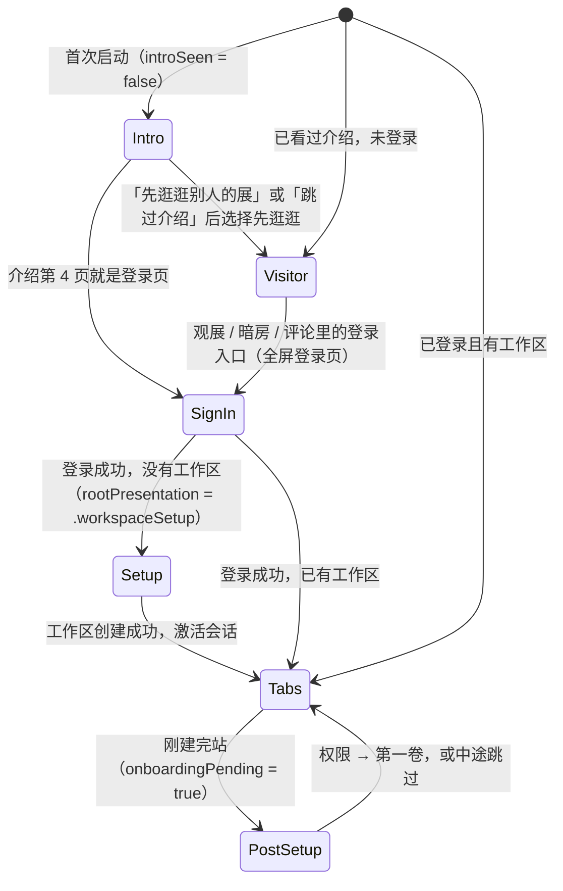

# iOS 重设计补完 · 登录 / Onboarding / 自定义 Sheet — Design

**日期：** 2026-11-02
**范围：** 11-02 重设计（`docs/superpowers/specs/2026-11-02-mobile-darkroom-redesign-design.md`）没有覆盖到的界面：登录前介绍、登录页、登录后 onboarding（建站 → 权限 → 第一卷）、所有弹出层（统一换成自定义 `AFSheet`）、订阅页、账号设置、暗房二级页。
**不含：** iPhone Duo 适配（下一个项目，等这里做完再做）。
**涉及：** `apps/mobile/Afilmory/App/**`（启动流程、`presentSignIn`、`presentSheet`）、`DesignSystem/**`（新增 `AFSheet`）、`Features/Authentication/**`、`Features/Billing/**`、`Features/Comments/**`、`Features/Exhibition/ExhibitionFilterSheet.swift`、`Features/Darkroom/**`、`Features/Studio/**`、`Resources/**`（介绍照片、String Catalog）、`Tests/**`。
**后端：** 不改。
**视觉参考：** 画板 `artboard/mobile-onboarding-sheets`（https://ryugi.innei.dev/a/8LPmjYMpCGdU4YESGM2sW）。讨论记录见文档 `document/mobile-remaining-redesign`（https://ryugi.innei.dev/a/ivgVCSuM4sErseI1xvpB4）。画板上的决定在本文里都有文字说明，`.ryugi/` 不一定提交到仓库，所以这里的文字是准。

## 意图

重设计把三个 Tab 和照片详情换成了「摄影展」的语言，但用户最先看到的几屏和所有弹出层还是系统样式：登录是一面三列滚动的照片墙加系统按钮，onboarding 只有一个表单，弹出层全部是系统 page sheet 加系统表单。用户从这些界面进出时，会掉回另一个 App。

这次要做的是让**新用户在第一分钟里知道这个 App 是做什么的、有什么特点、能给他带来什么**（这是你的原话），并且所有弹出层都说同一种视觉语言。

## 目标

- 第一次打开：曝光开场，接着 3 页介绍（展览、观展、暗房），然后登录或先逛逛。
- 新用户登录后依次完成三步：建站、权限、冲洗第一卷，结束时直接看到自己展厅里的照片。
- 所有弹出层都用同一个自定义 `AFSheet`，不再使用系统 page sheet 的样式。
- 登录页、订阅页、删除账号、onboarding 都改成全屏，并使用重设计的版式。
- 暗房的二级页不再掉回旧的系统列表样式。

## 非目标

- iPhone Duo、iPad 专属布局（iPad 上只做居中、限制最大宽度）。
- 后端、计费逻辑、App Store 商品配置。
- 订阅页的信息结构：方案、价格、恢复购买、条款都保持现状（合规要点见 `docs/superpowers/specs/2026-08-12-mobile-subscription-paywall-design.md`）。
- 暗房二级页的信息结构和功能。
- `DeveloperLabView` 只换底色，不做细化。

## 反目标（即使能用，出现这些也算失败）

- onboarding 像一份表单或设置向导：步骤指示太抢眼、页面上堆满字段。
- 介绍页或权限页出现编造的数据，比如虚构的用户名、评论或计数。
- 残留系统 sheet 样式：系统 grabber、系统导航栏标题、系统「完成」按钮。
- 动效挡住操作：转场还没结束就不能点、不能打断。
- 介绍页使用人物肖像。

## 约束

- iOS 26、Swift 6、UIKit 为主，SwiftUI 只作为内容托管在 `UIHostingController` 里。这些都和主 spec 一致。
- 设计 token 全部来自 `DesignSystem/AFTheme.swift`（颜色 `AFColor.*`、圆角 `AFRadius.*`、字体 `AFFont.*`），动效来自 `AFMotion`（`rackIn`、`defocus`、`refocus`、`expose`），强调色来自 `AccentExtractor`。不新增颜色值。
- 字体规则沿用主 spec：Schola 和思源宋体子集只用于 App 自带的文案，用户输入的内容（展厅名、评论）用系统字体。展厅名输入框按主 spec 的规则用 `AFFont.exhibitUser`，也就是 Schola，中文回落到系统字体。
- 「减弱动态效果」打开时，所有失焦、缩放、曝光动画改成淡入淡出（`AFMotion.reduceMotion`）。
- 文案用 String Catalog（`Localizable.xcstrings`），key 是英文原文。新加的中文标题要能被思源宋体子集覆盖，所以要重新跑一遍子集提取（主 spec 已经写了提取流程）。
- 「用 Apple 登录」必须继续使用系统的 `ASAuthorizationAppleIDButton`（现在包在 `NativeAppleAuthorizationButton` 里），样式选白色，`cornerRadius` 设为 26，和其他胶囊按钮的圆角一致。Apple 对这个按钮有审核要求，不要自己画。

## 启动与 onboarding 流程

- **`introSeen`**：存在 `UserDefaults` 里，作为本机标记。介绍的第 1–3 页显示完、或者用户点了「跳过介绍」，就设为 true。设置（暗房的账号 sheet）里加一个「重看介绍」入口，点了之后全屏重放介绍，最后一页的登录区换成「完成」。
- **`onboardingPending`**：本机标记。新工作区创建成功、会话激活之后设为 true。根视图切到 Tab 的同时，全屏盖上「权限 → 第一卷」两步，任何一步跳过或完成后清掉。之所以放在会话激活之后，是因为第一卷要真正上传，必须有已激活的会话。这是我的决定。
- **已有账号的用户**在新设备上登录：不走 PostSetup，也不再看介绍（登录成功时一并把 `introSeen` 设为 true）。
- 介绍和 onboarding 都是全屏页，一步一页。步骤之间用对焦转场：当前页 `defocus` 退后、下一页 `rackIn` 进来；返回时方向相反。支持从屏幕任意位置右滑返回，和主 spec 的 back-swipe 一致。

## 1. 登录前介绍（画板 q1-a、q5-a）

一共 4 页，版式完全相同，最后一页是登录（见下一节）。

- **开场**：第 1 页出现时先播放展览的曝光开场，复用 `AFMotion.expose` 和 `ExhibitionOpenerView` 的效果，播完后展签文字再 `rackIn`。
- **版式（q1-a 展签）**：照片卡左右各留 12pt、圆角 `AFRadius.card`（28），顶部距安全区约 18pt，高度大约占屏幕的 53%，按 aspect-fill 填满。照片卡下面是展签：
  - kicker：一个强调色小圆点，加 Schola 斜体，内容是「展览 · *No. 1*」
  - 标题：展品字体 34pt
  - 正文：SF 15pt，颜色 `textSecondary`，最多两行
- **强调色**：每页从自己那张照片里取色（`AccentExtractor`），用在 kicker 小圆点和进度点上。
- **进度（q5-a）**：主按钮上方一排小点。普通点 6×6，颜色 `AFColor.tick`；当前页的点拉长到 18×6，颜色用强调色。小点之间的间距是 6，切页时用 spring 动画过渡。**不用带文字的刻度**，你明确说过不要。
- **按钮**：主按钮是「继续」（`textPrimary` 底的胶囊，高 52），下面是文字按钮「跳过介绍」。点「跳过介绍」直接到第 4 页登录。
- **照片**：从 `photos/` 里挑出来、不含人物肖像的 4 张。处理成长边 1600px 的 HEIC 或 JPEG，每张不超过约 250KB，作为 asset 打包进 App。

| 页 | 照片 | kicker | 标题（en / zh） | 正文（en / zh） |
| --- | --- | --- | --- | --- |
| 1 | `photos/DSCF0842.jpg` 林中铜香炉 | Exhibition · No. 1 | Turn your photos into an exhibition / 把照片办成一场展 | Contact sheets cut by the day you shot them, at your own address. No layout work, and anyone can visit. / 按拍摄日剪成印样，有自己的网址。不用排版，谁都能来看。 |
| 2 | `photos/DSC_7132.jpg` 旅鸫 | Viewing · No. 2 | Walk through other galleries / 去逛别人的展 | Follow photographers you like and see their new rolls as soon as they're developed. / 关注喜欢的摄影师，他们一冲洗新照片你就能看到。 |
| 3 | `photos/IMG_0030.jpeg` 夜色楼阁 | Darkroom · No. 3 | Develop straight from your phone / 在手机上直接冲洗 | Pick, review, develop. EXIF and places are filed for you. / 选片、审片、冲洗，EXIF 和地点自动整理好。 |
| 4 | `photos/IMG_5469.HEIC` 日照金山 | Afilmory | Open a gallery of your own / 开一间自己的展厅 | After signing in, name your gallery and develop your first roll. / 登录后给展厅起个名字，再冲洗第一卷。 |

kicker 里的 *Exhibition / Viewing / Darkroom* 中文分别是「展览 / 观展 / 暗房」，沿用主 spec 定的英文名。

## 2. 登录页（画板 q2-a）

- 版式和介绍页一样，只是照片卡变矮（约占屏幕的 32%），正文下面换成一组登录按钮：
  1. 用 Apple 继续：系统按钮，白色，高 52
  2. GitHub 和 Google 两个描边胶囊按钮并排放（描边颜色 `AFColor.tick`）
  3. 文字按钮「使用邮箱登录」。点开后在原地展开邮箱和密码两个输入框，保留现在 `SignInView` 的说明文案：邮箱登录只面向受邀账号和 App Review 账号
- **条款同意开关保留**。它是 `593c1409 fix: add App Review UGC safety controls (#269)` 为 App Review 的 UGC 要求加的，逻辑不变：没打开开关就点登录，会提示错误。样式改成一行：左边是一个小号开关（tint 用 `accentFallback`），右边是 13pt 的「我同意 Afilmory 的使用条款和隐私政策」，两个名称是链接。这一行放在「使用邮箱登录」下面。
- 底部是「先逛逛别人的展 →」，只在介绍流程里、并且未登录时显示。
- **两种进入方式，用的是同一个页面：**
  - 在介绍流程里：作为第 4 页，带进度点，没有关闭按钮。
  - 从其他入口进来（访客点登录、评论区「更多方式」、会话过期）：全屏 present，左上角没有返回，右上角是一个圆形关闭按钮（`closebtn` 样式，44×44，`AFColor.fill` 底），没有进度点。照片用第 4 页那张。
- 登录逻辑、错误展示、各个登录方式的回调全部保持现状，只换 UI。

## 3. 建站（画板 q3-a）

替换现在 `WorkspaceSetupView` 的两步表单（`.name` 和 `.review`），改成一页：

- 标题：「给你的展厅起个名字 / Name your gallery」，展品字体 30pt。
- 字段 1：展厅名。上方是等宽小标签「展厅名」，输入框用 `AFFont.exhibitUser` 34pt，下面一条 1px 的 `AFColor.tick` 线，光标颜色用强调色（这一页还没有照片，用 `AFColor.accentFallback`）。默认值取 `WorkspaceOnboardingDefaults` 里的 `siteName`。
- 字段 2：网址。显示成「`afilmory.app/` + slug 胶囊」，slug 胶囊是 `AFColor.fill` 底、等宽字体、带一个铅笔图标。
  - **默认值**：沿用现在的规则，取 `WorkspaceOnboardingDefaults` 里的 `slug`（由账号名生成，比如 `innei`），**不跟着展厅名走**。原因是展厅名默认值是「Innei's Afilmory」这类长名字，中文展厅名经过 `normalizeSlug` 后还会变成空串。这是我的决定。
  - **编辑**：点击胶囊后变成可编辑，规则是 `normalizeSlug`，最少 3 个字符。
  - **可用状态**：停止输入约 400ms 后，用现有的 slug 检查接口（`WorkspaceSlugCheck`）查一次。可用时显示强调色的「✓ 可用」。被占用时，用 `AFColor.destructive` 显示「已被占用」，并给出第一个可用的后缀候选（`WorkspaceSlugResolver.firstAvailable`），比如「innei-2 可用，点一下使用」。
  - **提交**：提交时如果 slug 已经被别人占用，沿用现在的逻辑，自动取第一个可用的候选。
- 说明文字：「网址是展厅的公开地址，点一下可以改。自己的域名以后在暗房「站点」里绑定。」
- 主按钮「建好了，继续」固定在键盘上方。键盘默认弹出，焦点在展厅名上。
- **从 onboarding 里去掉**：「What should we call you?」这一步（用户显示名直接用账号资料，之后在暗房「站点」里改）、自定义域名字段、建站后的 CNAME 说明 sheet。自定义域名和 CNAME 说明只留在暗房的 `StudioDomainView`。
- **额度墙分支删掉**：`.needsUpgrade` 只会在绑定自定义域名时返回，域名字段去掉之后这条分支就走不到了。把它和相关的测试一起删掉，`finishOnboarding` 里请求自定义域名的那部分也删掉。
- **`.waiting` 状态**（工作区还在创建中）：用同一种版式，标题「展厅还在布置 / Your gallery is still being set up」，正文沿用现有文案，下面用等宽字体显示名称和 slug，主按钮是「退出登录」。
- 去掉 `NavigationStack` 和系统导航栏。顶部不需要任何东西，onboarding 的进度点只出现在后面两步。

## 4. 权限（画板 q6-b，按你的评论补过）

登录后的第二步，在 PostSetup 全屏页里。

- 标题：「两件小事，随时可以改 / Two small things, change them anytime」
- 引导语：「不给也能用。之后在系统设置里随时打开。」
- 两项说明，每项左边是一个 44pt 的圆形描边图标，右边是展品字体 20pt 的标题加一段说明：
  - **相册**：「选片、冲洗时读取照片和它的 EXIF、拍摄地点。只读你选中的照片。」下面配一张**展签预览**：缩略图用介绍第 1 页那张内置照片，旁边是 *No. 1* 和三行等宽 EXIF（机身 · 焦距 / 光圈 · 快门 · ISO / 地点）。EXIF 必须用这张照片的真实数据，在准备素材时提取出来写死；没有的字段就省略那一行。
  - **通知**：「你关注的摄影师发布新照片时提醒你。」后端现在只发这一种推送（`gallery-push.copy.ts`），评论、关注、冲洗完成这几种都没有，所以文案只能承诺这一种。下面配一条**通知横幅预览**，格式照搬真实推送：左边是 App 图标，标题「你关注的摄影师」，正文用 `galleryPushBody` 的模板「刚刚发布了 1 张新照片。」，右边是那张内置照片的缩略图。不能出现虚构的人名或头像，画板上的「山与人」只是占位。
- 进度点：一共 3 个点（建站、权限、第一卷），当前是第 2 个。建站页本身不显示进度点。
- 主按钮「允许并继续」：先请求相册权限（`PHPhotoLibrary.requestAuthorization(for: .readWrite)`，和 `PhotoUploadModule` 的级别一致），等结果回来后再请求通知权限（`GalleryNotificationPermissionCoordinator.requestAuthorization()`）。无论两个结果是什么，都进入下一步。
- 文字按钮「稍后再说」：不请求任何权限，直接进入下一步。
- 如果两个权限都已经决定过（不是 `.notDetermined`），这一步自动跳过。

## 5. 第一卷（画板 q7-a）

- 标题「冲洗第一卷 / Develop your first roll」，正文「挑几张你最满意的照片，冲洗完就挂进展厅。」
- 下面是三格「负片」条：介绍里三张内置照片做反相、低饱和、半透明处理，只是装饰。
- 主体直接复用暗房首页的冲洗卡片：光圈图标，「冲洗新照片」，副文案，「选择照片」主按钮。最好抽出同一个视图，不要复制一份。
- 点「选择照片」进入现有的 `DarkroomUploadFlow`：相册选择 → 审片 sheet → 开始冲洗。开始冲洗后关闭 PostSetup，切到展览 Tab，冲洗进度在展览和暗房里照常显示。
- 底部文字按钮「先去看看展厅」：直接关闭 PostSetup。
- 进度点：第 3 个。

## 6. `AFSheet`（画板 q4-a）

把 `Features/Darkroom/DarkroomSheetPresentation.swift` 里的 `DarkroomSheetController`、`DarkroomSheetPresentationController`、`DarkroomSheetAnimator` 移到 `DesignSystem/AFSheet.swift`，改名为 `AFSheetController` 等，暗房的两个 sheet 改为继承它。在现有能力上补齐以下几点：

- **外形**（不变）：四边留 `AFRadius.sheetInset`（8），圆角 `AFRadius.sheet`（47，continuous），`AFColor.sheet` 底，1px 描边（`textPrimary` 8% 透明度）。
- **头部（q4-a）**：grabber（36×5，`AFColor.tick`），下面一行，左边是展品字体 28pt 的标题，右边是 44×44 的圆形关闭按钮（`AFColor.fill` 底，`xmark` 图标）。标题可以带一个等宽副标题（比如评论 sheet 显示照片标题）。头部是组件的一部分，用的时候只传标题和副标题。
- **背景**：除了现在的 55% 黑色遮罩，背后的视图同时 `AFMotion.defocus`（轻微失焦，`amount` 大约 0.4），关闭时 `refocus`。减弱动态效果打开时只保留遮罩。
- **高度档位**：
  - `.fit`（默认）：高度跟随内容，就是现在的逻辑。
  - `.fitAndExpanded`：先停在 `.fit`（或者屏幕高度的 55%，取两者中较小的），可以往上拖到最大高度（屏幕高度减去顶部安全区，再减去 inset×2）。往下拖时，先从展开回落到初始高度，再往下才关闭。内容区的 scroll view 滚到顶之后才把拖动手势交给 sheet，和系统 sheet 的行为一致。
- **键盘**：sheet 底部跟着键盘上移（`keyboardLayoutGuide`），用于评论输入框和邮箱登录。
- **SwiftUI 托管**：提供一个便捷方法 `AFSheetController(title:subtitle:detents:content:)`，内部把 SwiftUI 内容包进 `UIHostingController`，作为子 VC 加入 `sheetContent`。
- **无障碍**：保留现在的 `accessibilityViewIsModal`、`accessibilityPerformEscape`，遮罩可以点击关闭。关闭按钮的标签是「关闭」。
- **Tab 栏**：保留现在的 `AppNavigator.shared.setTabBarHidden` 行为。
- 去掉 `ApplicationCoordinator.presentSheet` 里的系统 `pageSheet` 用法，改用 `AFSheet`。

## 7. 每个弹出层的去向

| 现在 | 改为 | 细节 |
| --- | --- | --- |
| 评论 `PhotoCommentsSheetView`（详情页、`CommentsLabPresenter`） | `AFSheet`，`.fitAndExpanded` | 标题「评论 · N」，副标题是照片标题。去掉 `UINavigationController` 和「Done」，输入框贴底并跟随键盘。关闭时照样回写评论数（`social.commentCount.setCount`）。 |
| 筛选 `ExhibitionFilterSheet` | `AFSheet`，`.fitAndExpanded` | 标题「筛选」。底部固定「应用」主按钮和「清除」文字按钮。 |
| 额度墙 `QuotaWallSheet` | `AFSheet`，`.fit` | 标题用 `QuotaWallReason` 的标题；用量表改成等宽字体的两列；主按钮「升级」打开订阅页（全屏）；次按钮是现有的替代方案文案（「先腾出空间」等）。 |
| 评论区登录 `CommentSignInView` | 仍然是评论 sheet 底部的内嵌栏，只换样式 | 它现在本来就不是独立弹层，不要在 sheet 上再叠一层。改成和输入框同高的一行：左边是「登录后参与评论」，右边是一个小号的「登录」胶囊。点「登录」先关闭评论 sheet，再打开全屏登录页，这样条款同意开关也走全屏页那一套。 |
| 账号 `DarkroomAccountSheetController` | `AFSheet`，`.fit` | 见第 9 节。 |
| 审片 `DarkroomReviewSheetController` | `AFSheet`（换个父类） | 外观不变。 |
| CNAME 说明 `WorkspaceCnameInstructionView` | `AFSheet`，`.fit` | 只从 `StudioDomainView` 打开。 |
| 登录 `SignInView`（从其他入口打开时） | 全屏 | 见第 2 节。iPad 上也全屏，内容列最大宽度 430pt，居中。 |
| 订阅 `SubscriptionView` | 全屏 | 见第 8 节。 |
| 账号设置 `AccountSettingsView` | 删除 | 功能并进账号 sheet，删除账号改成全屏流程。 |

## 8. 订阅页（画板 q8-a）

- 全屏 present，右上角圆形关闭按钮。
- 头图：顶部约 320pt 放一张用户自己的照片（优先用展览开场那张，没有照片时用介绍第 4 页的内置照片），底部渐变到 `AFColor.ground`，强调色从这张照片里取。头图上压着 kicker「*Afilmory Pro*」和展品字体标题「让展厅放得下更多」。
- 用量：等宽字体一行，比如「印样 18 / 20 帧 · 存储 327 MB / 1 GB」，下面是一条 3pt 的进度条，数据来自现有的 `billing/overview`。如果有 `focus` reason，对应那一项用强调色标出来。
- 方案：按现在 `OfferSectionView` 的分组（方案、存储），每组一个等宽小标题，每个可购买项是一张展签卡：左边是展品字体 20pt 的名称加说明，右边是等宽字体的 `displayPrice`。选中的卡描边用强调色，「当前」方案显示一个标记。名称、说明、价格全部来自服务端和 StoreKit，不写死。画板上的价格是占位。
- 底部：主按钮「订阅 {选中方案名}」，下面是一行等宽字体的「恢复购买 · 使用条款 · 隐私政策」。
- 「在网页上管理」的情况（Creem）沿用现在的逻辑，只换样式。

## 9. 账号 sheet 与删除账号

- 账号 sheet（`AFSheet`，`.fit`）：头部标题「账号」；身份卡不变（头像、展品字体名字、等宽字体的角色和邮箱）。下面依次是：
  1. 「管理订阅」：分组行，打开订阅页
  2. 「重看介绍」：分组行
  3. 「退出登录」：分组行
  4. 隔开一段距离后，单独一行 `AFColor.destructive` 文字「删除账号」
- 「删除账号」打开**全屏**的删除流程，内容和现在 `AccountSettingsView` 的删除部分一样：说明后果、列出名下工作区、用密码或「用 Apple 验证」重新认证、最后执行破坏性操作，完成后显示提示。版式用 onboarding 的单页结构，不用系统 Form。
- `AppNavigator.presentAccountSettings(startsDeletion:)`：`startsDeletion: true` 时直接打开删除流程，`false` 时打开账号 sheet。删除 `AccountSettingsView.swift`。

## 10. 暗房二级页

`StudioSiteView`、`StudioDomainView`、`StudioOperationsView`、`StudioAnalyticsView`、`StudioCommentsView` 托管在 `DarkroomSubpageController` 里，已经用了 `darkroomForm()`（只是把背景换掉了），分组和行还是系统 `List` 的样式。要统一成暗房首页「管理」那一组的样子（参考主 spec 和 `verify-darkroom-redesign` 的 h5-1）：

- 分组标题：等宽字体 11pt，大写或保持原样，颜色 `textTertiary`，字距 0.06em
- 分组卡：`AFColor.raised` 底，1px `AFColor.fill` 描边，圆角 `AFRadius.card`
- 行高至少 56，行之间是左侧缩进的 hairline 分隔线，主文字用 SF 17，右侧值用等宽 13 加 chevron
- 开关、选择器、输入框的 tint 用强调色（这一页没有照片时，用 `accentFallback`）

信息结构、路由、各个状态（加载、空、错误）都不变。`DeveloperLabView` 只换底色（`darkroomForm()`）。

## 留给实现者

- `AFSheet` 拖动手势和内部 scroll view 怎么协调。
- 介绍页、PostSetup 的容器用 `UIPageViewController` 还是自己写转场。前提是对焦转场要能被打断，右滑返回要可用。
- 各页在 SE 尺寸（375×667）上怎么压缩：照片卡的高度比例可以下调，但版式顺序不能变。
- 素材处理脚本，以及思源宋体子集的重新提取。
- 单元测试的划分。至少覆盖：`introSeen` / `onboardingPending` 的状态流转、权限步骤的跳过逻辑、`AFSheet` 档位计算、`presentAccountSettings` 的分支。

## 我自己做的决定（请检查）

1. **权限页的通知文案只承诺「关注的摄影师发布新照片」**，因为后端只发这一种推送。如果你想要评论、关注、冲洗完成的推送，那是另一个后端项目。
2. **网址默认取账号名，不跟着展厅名走**。被占用时实时给出带后缀的候选。
3. **条款同意开关保留**（它是为 App Review 加的），改成登录按钮下面的一行小开关。评论区的登录栏不再直接用 Apple 登录，统一跳到全屏登录页。
4. **权限和第一卷两步放在会话激活之后**，盖在 Tab 上面全屏显示，因为第一卷要真正上传。
5. **建站页去掉「What should we call you?」这一步**，用户显示名直接用账号资料；建站时的额度墙分支也一起删掉，因为没有自定义域名就走不到。
6. **介绍第 4 页（登录页）用 `IMG_5469`**，你只挑了 3 张，这是第 4 张。
7. **「重看介绍」放在账号 sheet 里**；已有账号在新设备上登录时，不显示介绍，也不走权限和第一卷两步。

## 验收

- 单元测试全部通过（`pnpm --filter @afilmory/mobile native:test`）。
- 在模拟器（`ios:local`）上依次走：全新安装 → 介绍 4 页 → 先逛逛 → 观展登录 → 新账号建站 → 权限 → 第一卷 → 展览。每一步截图，介绍到建站这一段录屏。
- 依次打开每一种 sheet（评论、筛选、额度墙、账号、审片、CNAME），各截图一张。评论 sheet 要截键盘弹起的状态，还要截访客看到的登录栏。
- 打开「减弱动态效果」后再走一遍介绍和一个 sheet。
- 中文和日文各截一组介绍页，检查思源宋体的覆盖情况。
- 截图和录屏放进画板，新建一组 verify，你在画板上判定通过或不通过。
